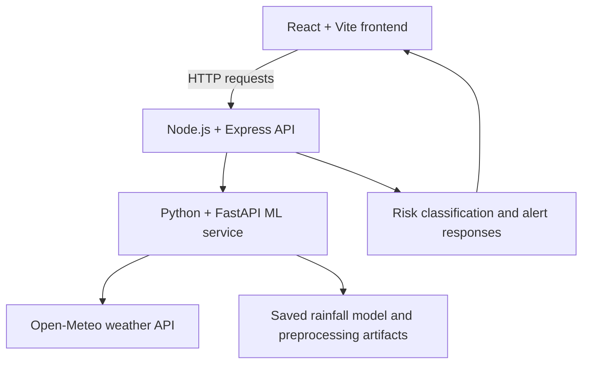

# AtmoNet — Tanzania Weather & Flood Early Warning

[](https://github.com/dier2003/atmonet)
[](https://github.com/dier2003/atmonet)
[](https://github.com/dier2003/atmonet)

**AtmoNet** is a full-stack weather intelligence and flood-risk awareness project focused on Tanzania. It brings together a React map interface, a Node.js API, and a Python machine-learning service for rainfall prediction and risk analysis.

> **Project status:** Active development / demonstration. Forecasts and risk levels are not official warnings.

## Live demo

- **Frontend:** [atmonet-frontend.onrender.com](https://atmonet-frontend.onrender.com/)
- **Source code:** [dier2003/atmonet](https://github.com/dier2003/atmonet)

The live interface may be unavailable during deployment or maintenance. The repository is the source of truth for current implementation details.

## Highlights

- Interactive map and region-aware weather views for Tanzania
- Rainfall prediction using a saved machine-learning model
- Flood-risk classification: LOW, MODERATE, HIGH, or CRITICAL
- Node.js/Express API for weather, predictions, alerts, and assistant endpoints
- Python/FastAPI ML service
- Open-Meteo weather-data integration
- Analytics and historical-data views in the user interface

## Architecture



## Technology stack

| Layer | Tools |
|---|---|
| Frontend | React, Vite, React Router, Leaflet, Recharts, Axios |
| Backend | Node.js, Express, CORS |
| ML service | Python, FastAPI, pandas, NumPy, scikit-learn, joblib |
| Weather data | Open-Meteo |
| Deployment | Render (service URLs configured through environment variables) |

## Repository layout

```text
atmonet/
├── frontend/       # React/Vite web interface
├── backend/        # Node.js/Express API
├── ml/             # ML prediction utilities
├── ml_service/     # FastAPI inference service and model artifacts
├── .env.example    # Example service configuration
├── CONTRIBUTING.md
├── SECURITY.md
├── LICENSE
└── README.md
```

## Run locally

Use separate terminals for the frontend, backend, and ML service.

### 1. Frontend

```bash
cd frontend
npm install
npm run dev
```

### 2. Backend

```bash
cd backend
npm install
npm run dev
```

Configure the frontend API URL and ML-service URL for your local environment as needed. Use `.env.example` as a reference and never commit real secrets.

### 3. Machine-learning service

```bash
cd ml_service
python -m venv .venv
```

**Windows PowerShell**
```powershell
.\.venv\Scripts\Activate.ps1
pip install -r requirements.txt
uvicorn main:app --reload --port 8000
```

**macOS / Linux**
```bash
source .venv/bin/activate
pip install -r requirements.txt
uvicorn main:app --reload --port 8000
```

Confirm the service URLs and ports in your local environment before starting all three services. Check the service health endpoints documented in the code.

## Configuration and security

- Copy `.env.example` to a local environment file and update URLs for your setup.
- Do not commit API keys, credentials, private tokens, or production secrets.
- Restrict CORS to trusted frontend origins for production.
- Validate request payloads and configure rate limiting.
- Use HTTPS and review authentication/authorization before production use.
- Keep model artifacts and preprocessing steps aligned.

## Validation and responsible use

AtmoNet is a research, educational, and demonstration project. Weather predictions and flood-risk classifications can be uncertain and **must not replace official forecasts, emergency alerts, evacuation instructions, or advice from Tanzania's responsible authorities**. Use official sources for safety-critical decisions.

## Screenshots

Screenshots of the current deployed interface should be added here after capturing them from the live application. No screenshot is embedded yet, so the README does not misrepresent an image as a current product view.

## Roadmap

- Validate model predictions against appropriate held-out and real-world data.
- Add automated tests and continuous integration.
- Improve monitoring, error handling, and API validation.
- Integrate verified water-level or IoT data where available.
- Add screenshots and a short demonstration walkthrough.
- Document limitations, data sources, and model evaluation results.

## Author

**Dnivo (Dier Focus)** · [GitHub @dier2003](https://github.com/dier2003)
